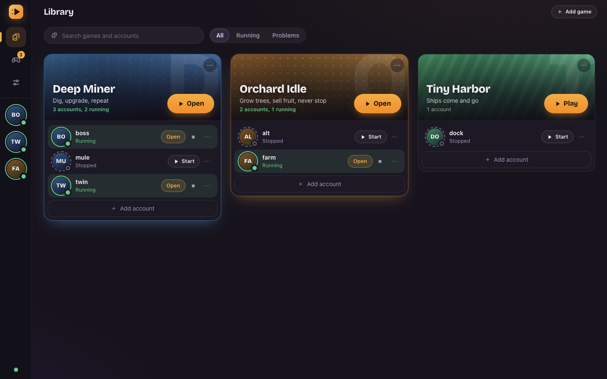
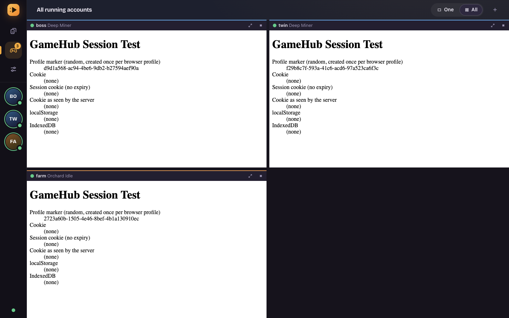
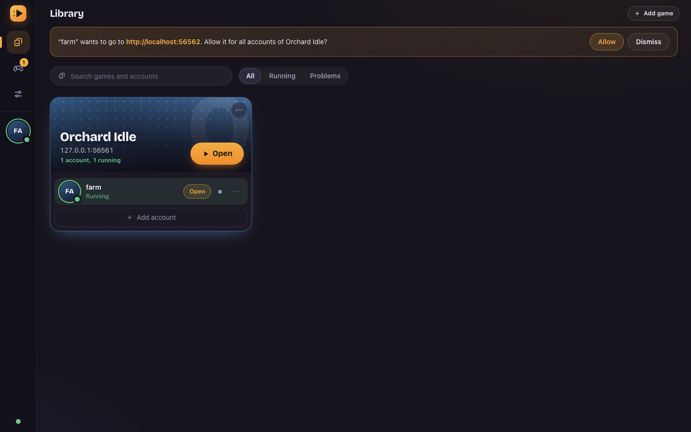
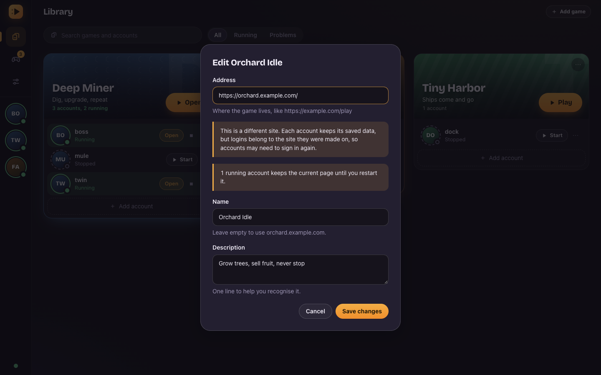

# GameHub

A desktop app for running **several accounts of the same web game side by side**, each one in its own
isolated, persistent browser.

Log into three accounts of one idle game, keep them all running, and jump between them. Their cookies,
storage and logins never touch each other, and they are still there after you close and reopen the app.



## What it does

- **One account = one browser.** Every account gets its own persistent Chromium session: cookies,
  `localStorage`, `IndexedDB`, cache and service workers. Two accounts of the same game never share state.
- **Library.** Every game is a poster with its own generated cover and colour, and its accounts are the party
  underneath: round portraits ringed by their state (stopped, starting, running, stopping, error, crashed), with
  only the actions that make sense for that state. **Play** is the one loud button. Managing a game (allowed
  sites, editing, removing) lives in its menu. Search and filters.
- **Play.** Open one account, or put all the running ones in a grid. The shell steps back (its top bar becomes
  the toolbar) and each game view is placed exactly where the interface asks, stepping aside for dialogs.
- **Sign-in popups.** OAuth popups run in the *same* session as the account that opened them, and only for
  sites you have allowed. Anything else is blocked, and the app asks before allowing it.
- **Persistent.** Accounts that were running come back when the app starts. Removing an account (or a game)
  deletes its browser data, even if the app is closed in the middle of it.
- **Plain feedback.** Loading, empty and error states, confirmations for destructive actions, and
  keyboard-friendly dialogs.



The three views above load the same address. The number each one shows is stored in *that account's*
browser, which is the isolation guarantee made visible.

### Asking before opening the door

A game can only navigate to its own site. When it tries to reach another one (a sign-in provider, for
example) GameHub blocks it and asks. **Allow** adds exactly that site to the game and redoes the
navigation; nothing about the destination's address leaves the main process.



### Editing a game

Changing a game's address is the one edit with consequences: logins belong to a *site*, so moving to another
site can sign accounts out, and running accounts stay on their current page until restarted. The form says so
before you save.



## Technology

| Area | What is used |
|---|---|
| Desktop shell | **Electron 45** (`WebContentsView`, custom `app://` protocol, `contextIsolation`, sandbox) |
| Language | **TypeScript 6** (strict) |
| UI | **React 19**, **Zustand 5** (read-model of what the main process reports), plain CSS with design tokens, native `<dialog>` and popover, **Bricolage Grotesque** (variable, bundled) for titles |
| Build | **Vite 8** with **electron-vite 6** |
| Persistence | **SQLite** through **better-sqlite3 13** and **Drizzle ORM 0.45** (migrations generated with drizzle-kit) |
| Validation | **zod 4** at every IPC boundary |
| Unit tests | **Vitest 5** |
| End-to-end tests | **Playwright 1.65** driving the real Electron app |
| Quality | **ESLint 10** with `typescript-eslint`, including rules that keep the process boundaries apart |
| Packages | **pnpm 10**, Node 22.12 or newer |

Not used on purpose: Tailwind and shadcn/ui (a native `<dialog>` and a small stylesheet cover what the UI
needs; see [ADR-0018](docs/decisions/0018-ui-state-and-styling.md)). Installers and auto-update are not set up
yet, so `electron-builder` is not a dependency.

## How it is built

```
Renderer (React, Zustand)         asks, never owns: it mirrors what the main process reports
   │  window.gamehub.*            a small, typed, validated API (preload, contextBridge)
Preload
   │  IPC, fixed channels, zod
Main process
   ├── InstanceManager            lifecycle of every account (state machine, one command at a time per account)
   ├── SessionManager             the only place that obtains an Electron session: persist:gh-<partitionId>
   ├── WindowManager              one window, one WebContentsView per running account, placed as requested
   ├── Navigation + popup policy  allowed sites per game, no popup chains, same-session popups
   ├── Repositories (SQLite)      metadata only: games, accounts, what to restore
   └── Logger                     structured, with secrets and query strings redacted

Game views                        remote content: sandboxed, no preload, no access to anything above
```

Who owns what:

- **SQLite** knows *what exists*: games, accounts, which ones to restore. It never stores cookies or tokens.
- **The Electron session** holds *the browser state*: cookies, storage, cache, logins.
- **The main process** owns every lifecycle and every game view. The renderer only mirrors it, through a
  snapshot plus events numbered with a sequence, and resyncs if it ever misses one.

Security, in short: game pages are treated as hostile. They get no preload and no Node, cannot reach the
shell's assets, can only navigate to sites you allowed, and are denied permissions and downloads by default.
Every IPC call is validated in the main process, sender frames are checked, and a layout request from the
interface cannot put a view outside the window.

The reasoning behind each decision is written down in [`docs/decisions/`](docs/decisions/README.md).

## Getting started

You need **Node 22.12+** and **pnpm 10**.

```bash
pnpm install
pnpm dev          # the app with hot reload for the interface
```

Other commands:

| Command | What it does |
|---|---|
| `pnpm build` | Builds main, preload and renderer into `out/` |
| `pnpm preview` | Runs the built app |
| `pnpm typecheck` | Type-checks the main, renderer and test projects |
| `pnpm lint` | ESLint, including the layer-boundary rules |
| `pnpm test` | Unit tests (Vitest) |
| `pnpm test:e2e` | Builds, then runs the end-to-end tests against the real Electron app |
| `pnpm db:generate --name <name>` | Generates a SQL migration after a schema change |

A note on terminals: some editors (VS Code among them) export `ELECTRON_RUN_AS_NODE=1` to child processes,
which makes Electron start as plain Node and fail to load. If `pnpm dev` or the E2E tests misbehave there,
run them with it unset (`env -u ELECTRON_RUN_AS_NODE pnpm dev`).

### Where your data lives

| | macOS | Windows |
|---|---|---|
| Installed app | `~/Library/Application Support/GameHub` | `%APPDATA%\GameHub` |
| `pnpm dev` | `~/Library/Application Support/GameHub-dev` | `%APPDATA%\GameHub-dev` |

The database is `gamehub.db` and each account's browser data is under `Partitions/`. In development the logs
are in `logs/` next to them. Development and tests never touch the installed app's data.

## Tests

- **452 unit tests** cover the state machine, the command queue, the session and instance managers, the
  navigation and popup policies, the `app://` path handling, event sequencing, the stores, the actions, the
  forms and the layout validation.
- **63 end-to-end tests** run against the real app and check, among other things, that two accounts of one
  game cannot see each other's cookies, `localStorage` or `IndexedDB`; that sessions survive a restart; that
  removal deletes the data; that popups stay in the right session; that the renderer has no Node access; and
  that the UI places every game view where it asked.

While developing, the isolation tests were also run against deliberately broken code (a shared partition, the
default session, a partition that changes every launch) to make sure they fail when they should.

## Project layout

```
src/
├── main/        Electron main process
│   ├── instances/         lifecycle, state machine, command queue
│   ├── browser-sessions/  SessionManager and per-session policy
│   ├── window/            WindowManager, popup controller, layout validation
│   ├── navigation/        allowed-site and popup policy (pure)
│   ├── notices/           "this game wants to reach another site" decisions
│   ├── persistence/       SQLite schema, repositories, tombstones
│   ├── ipc/               typed handlers, event publisher
│   ├── platform/          paths, the app:// protocol
│   ├── security/          global guards, shell origin check
│   └── logging/
├── preload/     the typed bridge exposed as window.gamehub
├── renderer/    React UI
│   ├── features/ components/ stores/ model/ hooks/ styles/
└── shared/      pure TypeScript used by every process (domain types, IPC contract)
drizzle/         SQL migrations
tests/           unit/, e2e/, and the fixture sites the tests run against
docs/            architecture, decisions (ADRs), development notes
```

## Status and known limits

GameHub works end to end on **macOS**. It has **not been tried on Windows** yet, and it is **not packaged**
(no installer, no auto-update). The things worth knowing before relying on it:

- **A cookie with no expiry date does not survive a restart.** That is browser behaviour, and it was left
  alone on purpose. Games that keep you signed in with a normal, lasting login are not affected.
- **Some sign-in providers refuse embedded browsers** (Google does). GameHub does not disguise itself to get
  around that.
- **Running accounts cost memory.** A hidden account is put in the background by Chromium, so its CPU is close
  to nothing, but its memory is not released: roughly 100-200 MB per account. Ten accounts of a light page
  take about 1.4 GB. See [ADR-0019](docs/decisions/0019-background-instances.md).
- Only the first nine running accounts fit in the "all" view of Play.

The full list, with the reasons, is in [`docs/development/known-limitations.md`](docs/development/known-limitations.md).
The plan and what is done are in [`docs/development/roadmap.md`](docs/development/roadmap.md).

## Documentation

- [Architecture overview](docs/architecture/overview.md)
- [Architecture decisions](docs/decisions/README.md) (ADR-0001 to ADR-0020)
- [UI design notes](docs/development/ui-design.md)
- [Known limitations](docs/development/known-limitations.md)
- [Roadmap](docs/development/roadmap.md)

## Working on this repository with Claude Code

Read [`CLAUDE.md`](CLAUDE.md) before making changes. The project skills live in `.claude/skills/`, and the
multi-instance browser rules in `.claude/skills/multi-instance-browser/SKILL.md`.

## License

No license has been chosen yet.
